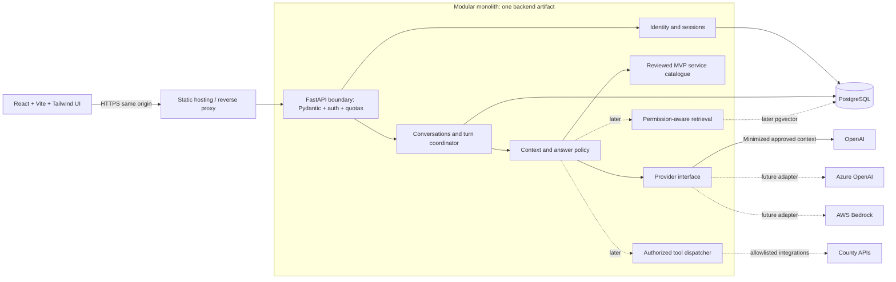
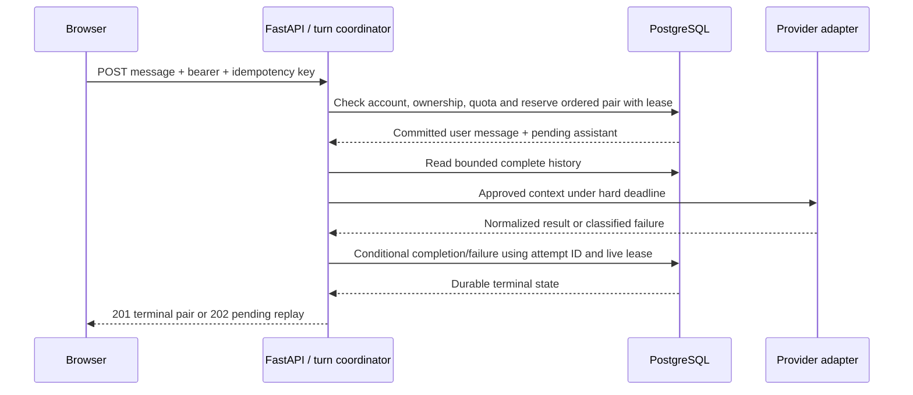

# Architecture

Status: Phase 0 target design, 2026-10-13; no application code exists.
Scope and targets come from [requirements](REQUIREMENTS.md). Rationale is recorded
in [ADR 0001](DECISIONS/0001-modular-monolith.md).

## Modular monolith and trust boundaries

One FastAPI backend artifact owns application modules and one PostgreSQL database.
React/Vite/Tailwind CSS produces a static frontend artifact. A same-origin reverse
proxy serves frontend assets and forwards `/api` requests; the Vite development
server is never the production server. Logical modules have public service interfaces;
they do not require network hops or independently managed databases.

Browser input, model output, retrieved text, and tool output are untrusted. The
application makes authorization decisions, not prompts or model-generated IDs.
Only the backend holds provider/database secrets. Infrastructure administrators do
not receive routine application access to conversation content.

## Proposed organization (directories not created in Phase 0)

| Area | Responsibility | Dependencies |
| --- | --- | --- |
| `frontend/src/features/auth` | Session/language UX; access token only in memory | Typed API client |
| `frontend/src/features/conversations` | Lists, messages, pending/error/retry UI | Typed API client; localized resources |
| `backend/app/api` | Route composition, Pydantic contracts, stable errors | Module public services |
| `backend/app/modules/identity` | Accounts, sessions, authorization | Identity repositories |
| `backend/app/modules/conversations` | Ownership, ordering, turn lifecycle, expiry | Repositories; AI service interface |
| `backend/app/modules/ai` | Context budget, answer policy, provider normalization | Provider port; catalogue/retrieval/tool ports |
| `backend/app/modules/knowledge` | Catalogue first; approved document ingestion/retrieval later | Knowledge repositories; embedding port later |
| `backend/app/modules/tools` | Deny-by-default schemas, policy and execution later | Allowlisted adapters |
| `backend/app/core` | Settings, lifecycle, error types, clocks, tracing | Minimal shared infrastructure |
| `backend/app/db` and `backend/migrations` | SQLAlchemy session factory; Alembic migrations | PostgreSQL |
| `tests`, `evals`, `infra` | Verification, reviewed benchmarks, Compose/CI/deployment definitions | Public contracts; synthetic inputs |

Route handlers delegate to services; services own transaction/policy boundaries;
repositories encapsulate SQL. A module must not reach into another module's private
repositories. Avoid a generic utility layer absorbing domain policy. Explicit
composition during FastAPI lifespan replaces network/model initialization at import.

## Request flow and durable turn lifecycle

The MVP uses synchronous HTTP completion with durable database state, not streaming
or a separate queue. The frontend can recover a lost response by reading messages
or replaying the same idempotency key. See [API](API_SPECIFICATION.md) and
[database design](DATABASE_DESIGN.md) for precise state transitions.

Never hold a database transaction or row lock while waiting for an LLM. Use an
async provider client with bounded connections and an SQLAlchemy AsyncSession per
task; sessions are not shared across concurrent tasks, following
[SQLAlchemy session guidance](https://docs.sqlalchemy.org/en/20/orm/session_basics.html).
After a crash, an operator-controlled periodic reconciliation job from the same
backend artifact marks expired pending attempts failed. Multiple reconcilers use
conditional updates/locking; no free-running unbounded in-process agent loop.

## Provider abstraction

Define a vendor-neutral `ChatProvider.generate` port taking normalized messages,
language, deadline, input/output budgets, permitted tool schemas (empty in MVP),
and expected response shape. Return text, normalized usage, finish status,
provider/model identity, provider request ID, and validated tool proposals. Map
authentication/configuration, throttling, transient transport, timeout, refusal,
and invalid-output failures to stable application error codes. Never return raw
SDK objects, exception bodies, or credentials through the API.

Initial adapter: OpenAI Responses API with explicit `store: false`; the application
loads its own context and does not depend on provider conversation IDs. This is a
stateless application design, not a promise of zero provider retention. Review
[OpenAI data controls](https://developers.openai.com/api/docs/guides/your-data)
before enabling real-data calls. [Conversation-state guidance](https://developers.openai.com/api/docs/guides/conversation-state)
supports passing application-managed history. Model ID and budgets are approved
configuration, not hardcoded recommendations; select them using bilingual evaluation.

Later adapters for Azure OpenAI and AWS Bedrock normalize the same port, using their
own identity, endpoints, request formats, and capability checks. Do not assume all
models support the same tools, structured output, context lengths, or retention.
An unsupported required capability fails startup or dispatch clearly. No automatic
cross-provider failover: it can change data destination, behavior, and cost.
Application-managed retry policy must account for SDK retries and stay inside one
30-second deadline; at most one transient retry, no retries for auth, validation,
or safety refusals. Unknown billing outcomes are recorded conservatively.

## Conversation memory

PostgreSQL is the source of truth. Use only this owner's conversation and completed
turn pairs from it. Keep trusted system instructions separate from user messages;
store neither system prompts nor hidden model reasoning as user history.

Build the input with: versioned system policy, preferred language, current approved
service-card evidence, and recent complete turns plus the current user message.
Input is capped at 8,000 tokens, output reservation at 2,000, and both must fit the
configured model context with a safety margin. Remove oldest complete pairs first;
do not truncate a source citation or an individual turn mid-message. If mandatory
evidence plus the current question will not fit, return `context_too_large` before
dispatch. A provider-specific tokenizer or conservative validated estimator enforces
the limit; character count alone is not a token estimate.

No cross-conversation memory, personal-profile extraction, automatic summaries,
or vectorizing citizen chats in the MVP. Summaries are future derived personal
data with their own provenance, expiry, access and deletion obligations. Deleted
or expired conversations cannot be read into context or revived through retries.

## Secure RAG (Phase 4, inactive in MVP)

The MVP evidence catalogue uses stable source IDs, version, county/department,
language, approved text, official URL, topic tags, reviewer, reviewed date, and
explicit review-due date. Validate the catalogue at startup; exclude overdue or
withdrawn cards at dispatch. The content owner sets intervals according to change
risk. Record the selected release per attempt; do not mix releases within one answer.
Dates, fees and contacts require expressly approved, current evidence. No matching
current evidence means abstention without a provider call where possible. Only
selected card IDs may be cited. Document RAG extends this boundary in Phase 4.

Ingestion is an explicit operator job, not a side effect of chat startup. Accept only
approved source files/URLs from county owners; scan type/size/malware, reject
unexpected active content, and sandbox extraction. Prevent SSRF through approved
hostnames, redirect revalidation, and blocked private/link-local addresses. Record
source URL, owner, checksum, language, effective/review dates, classification,
version, and page/section metadata before chunking and embedding.

Publish immutable document versions and embedding spaces; activate a corpus only
after review and benchmark checks. Never drop the live index during rebuild. Start
with exact pgvector similarity over authorized, current, approved public records;
benchmark lexical fallback and bilingual recall before approximate indexes or
reranking. pgvector documents exact and approximate search and filtering tradeoffs
in its [official repository](https://github.com/pgvector/pgvector).

Authorization predicates belong in the database retrieval query and must remain
effective with any approximate index; post-filtering returned text is insufficient.
Staff-only ingestion is a separate phase with an approved membership model and
row-level isolation tests. Retrieved instructions cannot alter system policy or
enable tools. Validate citation IDs against actual retrieved versions and communicate
missing/conflicting evidence. Withdrawn documents are immediately excluded; queued
purge covers chunks, embeddings, caches and external artifacts.

## Controlled tool calling (Phase 5, inactive in MVP)

The model proposes a tool name and JSON arguments. The backend derives actor and
scope from the session, looks up an allowlisted schema, validates arguments,
checks permission/resource scope, then executes under a timeout and quota. Validate
and minimize results before exposing them to the model. Limit a turn to at most
two tool executions and an overall bounded generation/tool cycle; audit denials
and successes without payloads. No shell, unrestricted HTTP, arbitrary SQL, or
model-supplied credentials. Begin with read-only tools. Record-changing tools later
require preview, explicit user confirmation tied to exact arguments, replay-safe
execution, officer authorization, and a new risk assessment.

## Infrastructure and observability

Docker Compose later provides frontend/proxy, backend and PostgreSQL for isolated
development; optional telemetry is a separate profile. Non-root images, locked
dependencies, private DB network, volumes and health checks are required. GitHub
Actions runs lint/types, unit/integration/contracts, frontend build, secret/dependency
checks and budget-free evaluation. Live API tests are opt-in; deployments require
approved protected environments. Phase 0 creates no Docker or workflow files.

For AWS, evaluate static asset hosting/CDN, container compute, managed PostgreSQL,
object storage, managed secrets, and telemetry. Region, service choices, pgvector
availability and transfer safeguards are separate deployment decisions; AWS does
not imply Kenyan data residency. Scale the monolith horizontally only after
database-backed locks/quotas and session revocation pass multi-worker tests.

Use structured trace/request/attempt IDs, provider/model/prompt/catalogue versions,
duration, usage, and error categories. Never log message bodies, passwords, tokens,
raw retrieved text, or unrestricted provider responses. See [SECURITY.md](SECURITY.md)
and [ROADMAP.md](ROADMAP.md) for release checks and operational targets.
