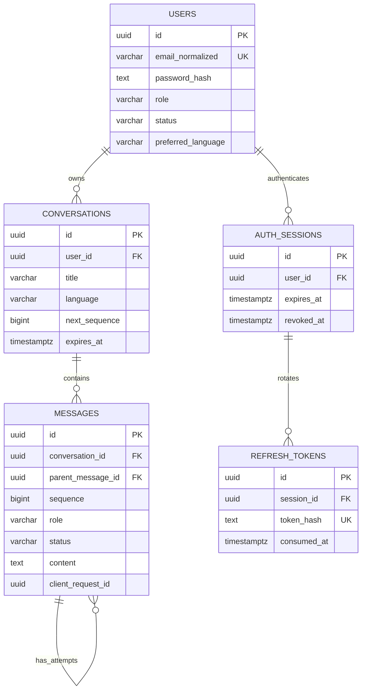

# Database design

Status: Phase 0 logical schema, 2026-10-13. No models, DDL or migrations are executed.
PostgreSQL is the authoritative store; SQLAlchemy maps application entities and
Alembic will manage schema changes. See [API](API_SPECIFICATION.md) and
[architecture](ARCHITECTURE.md). UUIDs are server-generated random identifiers;
all timestamps are timezone-aware UTC (`timestamptz`). IDs are not authorization.

## Relationships

## Core MVP tables

### `users`

| Column | Type / nullability | Rule |
| --- | --- | --- |
| `id` | uuid PK, required | Public account ID, generated by server |
| `email_normalized` | varchar(254), required | Unique; pilot policy uses trimmed lowercase emails, consistently at provisioning/login |
| `password_hash` | text, required | Argon2id encoded hash; never plaintext or reversible encryption |
| `role` | varchar(16), required | CHECK `citizen`, `staff`, `admin`; server-managed |
| `status` | varchar(16), required | CHECK `active`, `disabled`; default `active` |
| `preferred_language` | varchar(2), required | CHECK `en`, `sw`; default `en` |
| `token_version` | integer, required | >=0; default 0, increment for global session invalidation |
| `privacy_notice_version` | varchar(64), required | Version shown/acknowledged at invitation acceptance; not proof of a legal basis |
| `created_at`, `updated_at` | timestamptz, required | Server timestamps |

No national ID, date of birth, phone number, ethnicity, or inferred citizen profile.
Role assignment occurs only through an audited operator procedure in the pilot;
the public API cannot submit role/status/token-version fields. Email changes,
credential recovery and public registration require a later approved identity flow.

### `conversations`

| Column | Type / nullability | Rule |
| --- | --- | --- |
| `id` | uuid PK, required | Generated by server |
| `user_id` | uuid FK users, required | `ON DELETE CASCADE`; never client assigned |
| `title` | varchar(120), required | Default localized new-conversation title; no automatic title generation from sensitive text |
| `language` | varchar(2), required | CHECK `en`, `sw`; creation uses user preference if omitted |
| `next_sequence` | bigint, required | >=1; default 1; increment under conversation row lock |
| `version` | bigint, required | >=1; optimistic concurrency for metadata mutation |
| `last_activity_at` | timestamptz, required | Creation or accepted new user turn; rename/replay/retry does not extend retention |
| `expires_at` | timestamptz, required | Earliest of creation +90 days and last activity +30 days; proposed pilot policy |
| `created_at`, `updated_at` | timestamptz, required | Server maintained |

Indexes: `(user_id, updated_at DESC, id DESC)` for cursor listings and `(expires_at)`
for purge. Expired rows are immediately invisible to reads/sends/retries even before
scheduled purge. PostgreSQL CHECKs can enforce local timestamp ordering; expiry
formula is recomputed by service policy on accepted new turns and tested explicitly.

### `messages`

One user row represents a logical turn; one or more assistant rows represent
attempts to answer it. Failed attempts remain visible with safe metadata until
conversation deletion/expiry. They never enter context as answered history.

| Column | Type / nullability | Rule |
| --- | --- | --- |
| `id` | uuid PK, required | Generated by server |
| `conversation_id` | uuid FK conversations, required | `ON DELETE CASCADE` |
| `sequence` | bigint, required | >=1; unique per conversation; stable ascending order, gaps allowed |
| `role` | varchar(16), required | CHECK `user`, `assistant`; no client-supplied system/tool roles |
| `status` | varchar(16), required | CHECK `completed`, `pending`, `failed` |
| `content` | text, nullable | User: required nonblank <=4,000 characters, always completed; assistant pending/failed: NULL; completed: nonblank <=16,000 characters |
| `language` | varchar(2), required | CHECK `en`, `sw`; reply preference snapshot for the turn |
| `parent_message_id` | uuid, nullable | User NULL; assistant required, references its user message in same conversation |
| `client_request_id` | uuid, nullable | Initial send key on user row; retry key on retry assistant row; initial assistant NULL |
| `request_hash` | char(64), nullable | Canonical operation/payload hash required with a client request key |
| `attempt_id` | uuid, nullable | Unique, required for assistant attempts; internal fencing identifier |
| `lease_until` | timestamptz, nullable | Required only while pending; reservation +45 s; clear on terminal state |
| `answer_kind` | varchar(16), nullable | Completed assistant only: CHECK `answer`, `abstention`, `refusal` |
| `error_code` | varchar(64), nullable | Failed assistant only: stable safe category, no upstream exception text |
| `citations` | jsonb, required | Default `[]`; validated typed array of catalogue references in MVP; document references later |
| `provider`, `model_id`, `prompt_version`, `catalogue_version` | varchar(128), nullable | Server-recorded assistant artifact identities; never account credentials |
| `input_tokens`, `output_tokens` | integer, nullable | Nonnegative when known; NULL is unknown, not zero |
| `created_at`, `completed_at` | timestamptz | Created required; terminal timestamp required for completed/failed rows |

Constraints: unique `(conversation_id, sequence)`; unique
`(conversation_id, client_request_id)` where key is not NULL; unique
`(conversation_id, id)` supporting a same-conversation composite parent FK;
partial unique `(conversation_id)` where role=assistant and status=pending;
partial unique `(parent_message_id)` where role=assistant and status=completed.
Apply row-state CHECKs matching the table above. The composite parent FK restricts
deletion of an individual referenced user row; delete the entire conversation through
its cascade. A same-conversation FK does not enforce parent role: application
invariants (and a trigger if chosen during implementation) must enforce user parent.
Individual edit/delete message endpoints are deliberately absent in the MVP.

Index `(conversation_id, sequence)` supports ascending cursor reads; partial index
on `lease_until` for pending assistants supports recovery. Citations, errors and
metadata are validated by Pydantic and bounded before persistence. Do not store
raw SDK responses, hidden reasoning, access tokens, or request bodies in JSONB.

## Authentication support (required with MVP authentication)

`auth_sessions`: uuid `id` PK, required `user_id` FK with cascade, created/last-seen
timestamps, absolute `expires_at` (creation +7 days), nullable `revoked_at`, and
`token_version` snapshot. Index user and expiry. Session ID (`sid`) in access JWT
must resolve to an unrevoked, unexpired session for the active account.

`refresh_tokens`: uuid `id` PK, required `session_id` FK with cascade, unique
SHA-256 `token_hash`, created/expiry timestamps, nullable `consumed_at` and
`revoked_at`. Tokens are random >=256-bit opaque values; hashing high-entropy
tokens is appropriate here, unlike unsalted hashes of low-entropy personal IDs.
Keep consumed hashes until session expiry so any recognized refresh-token replay
can revoke the session family. Consume/rotate atomically under session lock;
reject reuse and revoke family in a committed security transaction. Raw token
appears only in the secure cookie. Client refresh requests are serialized.

## Send, retry and recovery transactions

1. Authenticate, resolve active session/account and owned unexpired conversation,
   and validate input. For a previously
   used key, verify request hash and return its existing state without a provider
   call. A mismatching hash returns 409.
2. Lock the owned, unexpired conversation row. Reject another live pending attempt
   or any new user turn while the latest user turn has no completed answer (409).
   Atomically reserve quota/budget, allocate sequence numbers and insert a completed
   user row plus pending assistant row. Commit before external calls.
3. Read authorized bounded history, release DB transaction, invoke provider under
   30 s deadline. On completion, in a new short transaction fence by attempt ID,
   status=pending, live lease, and unexpired existing conversation; update exactly
   that assistant and finalize usage reservation. Late output is discarded.
4. Failure persists a failed assistant and safe code. Cancellation/crash may leave a
   pending row. Reconcile every 15 s: expired leases become failed, release concurrency
   slots, and conservatively settle unknown usage. Recovery objective is <=60 s
   after lease expiry. Never resurrect deleted or expired conversations.
5. Retry inserts another pending assistant for the same latest user row with a new
   retry key and sequence. Do not duplicate the user message or reorder earlier turns.
   Permit retry only when latest turn has no completed answer and no live pending
   attempt. First successful answer wins; unique constraints/fencing prevent double
   completion. A newly submitted question waits for success or a new conversation.

Deleting a conversation locks it, fences pending work through removal, and cascades
messages atomically. In-flight provider calls may still finish/charge; their output
is discarded and minimal accounting remains separate from deleted content.

Phase 3 also needs a PostgreSQL-backed `ai_usage_reservations` ledger: actor,
conversation/attempt references nullable on deletion, UTC accounting window,
reserved and actual nonnegative token/cost amounts, state (`reserved`, `settled`,
`unknown`), and timestamps. Lock per-user/global budget counters before dispatch;
settle idempotently by unique attempt ID. Store no messages in this ledger. Detailed
ledger migration and shared rate-limit counters belong to Phase 3 implementation
review; quotas cannot rely on process memory. Minimal audit records use a separate
append-only sink per [SECURITY.md](SECURITY.md).

## Future document RAG schema (not MVP migrations)

| Entity | Planned fields / relationships |
| --- | --- |
| `documents` | UUID, county/department, owner, official source URL, classification, withdrawal timestamp |
| `document_versions` | Document FK, unique version, content checksum, language, effective/review dates, approved reviewer, approval status, immutable storage key |
| `document_chunks` | Version FK, ordinal, text, page/section, chunk checksum; cascade on approved purge |
| `embedding_spaces` | Provider/model/revision, dimension, tokenizer/chunking policy, metric, active corpus version |
| `chunk_embeddings` | Chunk FK, embedding-space FK, vector of fixed compatible dimension, unique chunk/space |
| `corpus_releases` | Version, approved version membership, activation time, rollback target |

Do not mix embedding dimensions or different embedding spaces in a distance query.
Create fixed-dimension storage/indexes through a migration when a model is selected.
Public documents only initially. Staff scope requires a separately designed
membership/ACL schema, database policies and tests before restricted ingestion.
Never embed conversations as document knowledge. Use exact search first; approximate
indexes require measured filtered recall. Historical citations retain immutable
source identity but must not expose withdrawn/private content after permissions change.

## Migration, lifecycle and recovery

Use explicit migrations, reviewed SQLAlchemy constraints and parameterized queries;
the runtime DB role cannot run DDL or bypass future isolation policies. Test empty
database upgrade, schema validation, and backup restoration with real PostgreSQL,
not SQLite substitutes. Keep provider calls outside transactions, set query/lock
timeouts, and release sessions on cancellation/error. Use expand/contract migrations
for deployed changes; recovery may be restore/forward fix rather than unsafe downgrade.

Proposed retention and erasure are in [SECURITY.md](SECURITY.md). Expiry is enforced
in query predicates; scheduled physical deletion clears messages/caches. Account
deletion through the verified rights process cascades conversations and sessions
unless a documented applicable hold prevents it. No indefinite soft-delete archive
of chat bodies. Encrypted backups are access-controlled and expire; deletion records
are reapplied before any restored database is made available.
