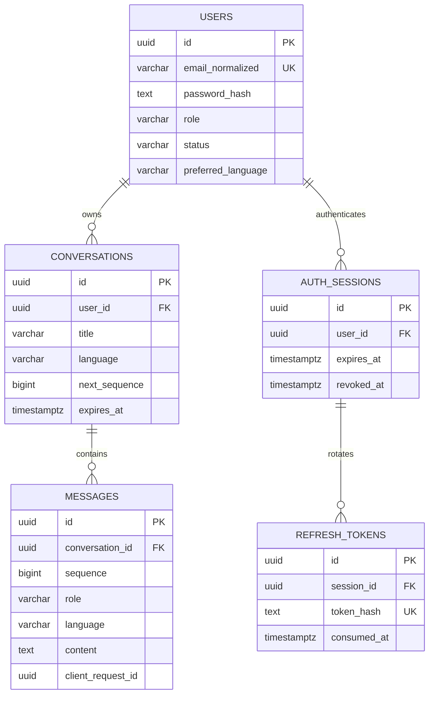

# Database design

Status: Phase 0 logical domain schema with P1-02 infrastructure, updated 2026-10-16.
The immutable baseline is followed by P2-01 identity revisions 0002/0003/0004,
validated on disposable PostgreSQL 17 under explicit synthetic-test authorization.
P2-03 conversation/message source and revision 0005 are prepared; runtime
verification and a separate changed-exposure decision remain pending.
PostgreSQL is the authoritative store; SQLAlchemy maps application entities and
Alembic manages explicit reviewed schema changes. See [API](API_SPECIFICATION.md) and
[architecture](ARCHITECTURE.md). UUIDs are server-generated random identifiers;
all timestamps are timezone-aware UTC (`timestamptz`). IDs are not authorization.

## Relationships

## Core MVP tables

### `users`

| Column | Type / nullability | Rule |
| --- | --- | --- |
| `id` | uuid PK, required | Public account ID, generated by server |
| `email_normalized` | varchar(254), required | Unique; pilot policy uses trimmed lowercase emails, consistently at provisioning/login |
| `password_hash` | text, required | Argon2id encoded hash; never plaintext or reversible encryption |
| `role` | varchar(16), required | CHECK `citizen`, `staff`, `admin`; server-managed |
| `status` | varchar(16), required | CHECK `active`, `disabled`; default `active` |
| `preferred_language` | varchar(2), required | CHECK `en`, `sw`; default `en` |
| `token_version` | integer, required | >=0; default 0, increment for global session invalidation |
| `privacy_notice_version` | varchar(64), required | Version shown/acknowledged at invitation acceptance; not proof of a legal basis |
| `created_at`, `updated_at` | timestamptz, required | Server timestamps |

No national ID, date of birth, phone number, ethnicity, or inferred citizen profile.
Role assignment occurs only through an audited operator procedure in the pilot;
the public API cannot submit role/status/token-version fields. Email changes,
public recovery and public registration require a later approved identity flow.
Synthetic operator-assisted reset is specified by the P2-01 contract below.

### `conversations`

| Column | Type / nullability | Rule |
| --- | --- | --- |
| `id` | uuid PK, required | Generated by server |
| `user_id` | uuid FK users, required | `ON DELETE CASCADE`; never client assigned |
| `title` | varchar(120), required | Default localized new-conversation title; no automatic title generation from sensitive text |
| `language` | varchar(2), required | CHECK `en`, `sw`; creation uses user preference if omitted |
| `next_sequence` | bigint, required | >=1; default 1; increment under conversation row lock |
| `version` | bigint, required | >=1; optimistic concurrency for metadata mutation |
| `last_activity_at` | timestamptz, required | Creation or accepted new user turn; rename/replay/retry does not extend retention |
| `expires_at` | timestamptz, required | Earliest of creation +90 days and last activity +30 days; proposed pilot policy |
| `created_at`, `updated_at` | timestamptz, required | Server maintained |

Indexes: `(user_id, updated_at DESC, id DESC)` for cursor listings and `(expires_at)`
for purge. Expired rows are immediately invisible to reads/sends/retries even before
scheduled purge. PostgreSQL CHECKs can enforce local timestamp ordering; expiry
formula is recomputed by service policy on accepted new turns and tested explicitly.

### `messages` (Phase 2 amendment)

One row is a persisted user message, including a valid unanswered message. Phase 2
never creates an assistant row. The historical paired-attempt schema is superseded
by [ADR 0003](DECISIONS/0003-separate-message-persistence.md); assistant attempt fields
require a separate Phase 3 migration and approved generation contracts.

| Column | Type / nullability | Rule |
| --- | --- | --- |
| id | uuid PK, required | Server-generated |
| conversation_id | uuid FK, required | conversations.id ON DELETE CASCADE |
| sequence | bigint, required | >=1; unique per conversation; immutable ascending order |
| role | varchar(16), required | CHECK role=user; server assigned |
| content | text, required | Nonblank <=4,000 Unicode characters, validated UTF-8 and no NUL |
| language | varchar(2), required | en/sw, preference snapshot at insertion |
| client_request_id | uuid, required | Persistence Idempotency-Key; unique with conversation_id |
| request_hash | varchar(64), required | CHECK lowercase hex SHA-256 of canonical normalized content |
| created_at | timestamptz, required | Server timestamp |

Unique (conversation_id,sequence) supports ordered reads; unique
(conversation_id,client_request_id) prevents duplicate persistence. Runtime may
SELECT/INSERT messages, never directly UPDATE/DELETE them. Deleting a conversation
uses its FK cascade. Runtime conversation UPDATE grants exclude ownership, IDs and
creation timestamp. Auth/account locks serialize per-user caps and session revocation;
conversation locks serialize idempotency lookup/sequence allocation/insertion.
No provider payloads, tokens, hidden reasoning or arbitrary JSON are persisted.

## Authentication support (required with MVP authentication)

`auth_sessions`: uuid `id` PK, required `user_id` FK with cascade, created/last-seen
timestamps, absolute `expires_at` (creation +7 days), nullable `revoked_at`, and
`token_version` snapshot. Index user and expiry. Session ID (`sid`) in access JWT
must resolve to an unrevoked, unexpired session for the active account.

`refresh_tokens`: uuid `id` PK, required `session_id` FK with cascade, unique
SHA-256 `token_hash`, created/expiry timestamps, nullable `consumed_at` and
`revoked_at`. Tokens are random >=256-bit opaque values; hashing high-entropy
tokens is appropriate here, unlike unsalted hashes of low-entropy personal IDs.
Keep consumed hashes until session expiry so any recognized refresh-token replay
can revoke the session family. Consume/rotate atomically under session lock;
reject reuse and revoke family in a committed security transaction. Raw token
appears only in the secure cookie. Client refresh requests are serialized.

## Persistence transactions and future generation boundary

Authenticate and lock the current active account/session using the approved identity
service; then lock the owned, unexpired conversation. Conceal missing/other-owner/
expired rows with 404, including writes. Check idempotency before caps or allocating
sequence; identical replay returns the original row without extending retention.
Insert a new user message, increment sequence/version, update activity/expiry and
append a content-free pseudonymous audit event in one transaction. Mandatory audit
or database failure rolls everything back and returns safe 503. No external calls
occur inside or outside these transactions in Phase 2. Queries use bound parameters.

Deletion locks the conversation and cascades all messages atomically; account deletion
also cascades through conversations. Logical expiry is enforced immediately in every
query; scheduled physical purge within 24 hours remains P2-05 work, not claimed here.

Phase 3 generation, assistant state/fencing, retry/recovery and usage reservations
need a separate contract and migration review. They must not change the meaning of
Phase 2 persistence or require an unanswered user message to have an assistant row.

## Future document RAG schema (not MVP migrations)

| Entity | Planned fields / relationships |
| --- | --- |
| `documents` | UUID, county/department, owner, official source URL, classification, withdrawal timestamp |
| `document_versions` | Document FK, unique version, content checksum, language, effective/review dates, approved reviewer, approval status, immutable storage key |
| `document_chunks` | Version FK, ordinal, text, page/section, chunk checksum; cascade on approved purge |
| `embedding_spaces` | Provider/model/revision, dimension, tokenizer/chunking policy, metric, active corpus version |
| `chunk_embeddings` | Chunk FK, embedding-space FK, vector of fixed compatible dimension, unique chunk/space |
| `corpus_releases` | Version, approved version membership, activation time, rollback target |

Do not mix embedding dimensions or different embedding spaces in a distance query.
Create fixed-dimension storage/indexes through a migration when a model is selected.
Public documents only initially. Staff scope requires a separately designed
membership/ACL schema, database policies and tests before restricted ingestion.
Never embed conversations as document knowledge. Use exact search first; approximate
indexes require measured filtered recall. Historical citations retain immutable
source identity but must not expose withdrawn/private content after permissions change.

## Migration, lifecycle and recovery

Use explicit migrations, reviewed SQLAlchemy constraints and parameterized queries;
the runtime DB role cannot run DDL or bypass future isolation policies. Test empty
database upgrade, schema validation, and backup restoration with real PostgreSQL,
not SQLite substitutes. Keep provider calls outside transactions, set query/lock
timeouts, and release sessions on cancellation/error. Use expand/contract migrations
for deployed changes; recovery may be restore/forward fix rather than unsafe downgrade.

Proposed retention and erasure are in [SECURITY.md](SECURITY.md). Expiry is enforced
in query predicates; scheduled physical deletion clears messages/caches. Account
deletion through the verified rights process cascades conversations and sessions
unless a documented applicable hold prevents it. No indefinite soft-delete archive
of chat bodies. Encrypted backups are access-controlled and expire; deletion records
are reapplied before any restored database is made available.

## Implemented P1-02 infrastructure boundary

The domain schema above is still future work. P1-02 adds empty SQLAlchemy metadata,
a lazy async engine/session factory, and immutable `0001_baseline`, creating only
`public.alembic_version`. No users, sessions, conversations or messages tables exist.
Runtime cannot migrate or mutate revision state. See
[database operations](DATABASE_OPERATIONS.md) for privileges and explicit commands.

## P2-01 identity schema (explicit revisions, restricted validation)

Fixed users.role remains citizen/staff/admin; no normalized role/permission tables.
Add users.privacy_notice_acknowledged_at (required timestamptz). Pending invitation
recipients have no user row until activation; password_hash stays non-null. The
following records are SQLAlchemy models and explicit Alembic migrations,
never automatically created metadata. See [authentication contract](AUTHENTICATION.md).

| Table | Columns and constraints | Index/lifecycle |
| --- | --- | --- |
| invitations | UUID PK; normalized email <=254; purpose activation/password_reset; nullable target_user_id FK for reset only; fixed role; en/sw language; notice version; unique char(64) token_digest; pseudonymous issuer; created_at/expires_at; consumed_at/revoked_at nullable; accepted_user_id FK nullable | Partial unique email/purpose where consumed_at and revoked_at are NULL; expiry index; replacement revokes prior outstanding rows, including expired; 24-hour lifetime; reset requires target user, activation forbids target user |
| auth_sessions | UUID PK; user_id FK ON DELETE CASCADE; created_at, expires_at, last_used_at; nullable revoked_at/reason | User/created_at/id listing index; expiry index; expires_at=login+7 days; nondecreasing timestamps; revocation cannot reactivate |
| refresh_tokens | UUID PK; session_id FK CASCADE; unique char(64) token_digest; created_at/expires_at; consumed_at nullable; replaced_by_id nullable | Partial unique session_id for unconsumed token; same-family replacement via composite FK; unique predecessor linkage; consumed history retained through expiry and purged within 24 hours |
| auth_audit_events | UUID PK; occurred_at; actor/subject pseudonym nullable; allowlisted action/outcome; generated request_id UUID; bounded validated metadata | occurred_at and subject/time indexes; no secrets/bodies/raw email/IP; insert-only runtime grant, separate retention operator; 90-day proposed retention |
| auth_rate_limits | Dimension plus HMAC identifier and window key composite PK; count nonnegative; window start/end; optional blocked_until | Expiry index and bounded cleanup; atomic counters for account/IP and other auth abuse dimensions across workers; no raw submitted identity |

Every timestamp uses timestamptz; digest inputs are high-entropy random secrets,
not passwords. Invitation consumption/user creation/audit commit atomically with
email uniqueness as the final duplicate guard. Password hashing precedes row locks;
service revalidates state under lock. Family-first locking and guarded updates
coordinate refresh/revoke/reset/disable; revocation/audit must commit before a denial.
Use local CHECKs for enum/length/timestamp ordering and cross-row service/transaction
checks for family expiry, one-time consumption and account version invariants.

Implemented revisions: 0002_identity_accounts (users/invitations),
0003_identity_sessions (families/lineage), 0004_auth_controls (audit/counters).
Do not alter 0001_baseline. Seed no accounts/passwords. Role names are CHECK values,
not seeded login identities. Runtime receives only needed SELECT/INSERT/DELETE and
column-specific UPDATE privileges: never invitation issuance, role/status mutation,
audit alteration, schema DDL or revision writes. Separate restricted operator and
maintenance roles handle provisioning/reset/disable and retention. Test grants and
schema from the packaged wheel on actual PostgreSQL 17 before claiming completion.
No application startup migration. Deployed recovery favors forward repair/restore;
any downgrade destroying account/session data is explicitly destructive, not a
routine recovery instruction. Conversations/messages remain later Phase 2 work.

## P2-03 explicit migration boundary

0005_conversation_persistence follows 0004 without altering historical revisions.
It creates conversations/messages, constraints and ownership/expiry/sequence indexes.
The existing explicit grants command adds the minimum runtime privileges; no startup
migration or schema creation is introduced. Downgrade to 0004 is deliberately
destructive for conversation history, preserves identity, and is tested only on
disposable databases after runtime authorization. Forward repair/restore is preferred
for retained data. Tests compare actual schema and model metadata before completion.

## P2-05 privacy controls (migration 0006_privacy_lifecycle)

Owner-approved synthetic engineering policy, 19 October 2026; runtime validation
pending. Existing expiry/sequence/message schema and their retention constraints
are unchanged. New tables hold control metadata, never copies of conversation bodies:

| Table | Keys and controls |
| --- | --- |
| privacy_operators | Authenticated PostgreSQL role PK; enabled and explicit hold/request/maintenance capabilities; empty by default; only reviewed DB-owner enrollment |
| privacy_holds | UUID PK; account/conversation target UUIDs; fixed reason and case reference; immutable issuer/creation/scope; pseudonymous audit subject; 30-day review deadline; audited explicit release |
| privacy_deletion_requests | UUID retry key; canonical unique live user FK SET NULL; target digest/case reference; actual receipt/acceptance and service dates; accepted/held/completed; completion requires the user FK be NULL |
| privacy_deletion_ledger | Unique kind/UUID; physical deletion time; 37-day expiry matching backup-window-plus-seven-day proposal |
| privacy_maintenance_state | Singleton daily/success/hold-alert timestamps and enrolled audit-key fingerprint; no secrets |

Released hold metadata uses durable UUID references without cascade FKs so physical
purge cannot erase hold review evidence. Creation validates the locked real target;
released evidence expires after the existing 90-day minimal audit window. Completed
request metadata likewise expires after 90 days. These are synthetic audit/control
metadata choices, not a statutory records schedule.

The account-to-conversation-to-message and session-to-refresh-token FKs still cascade.
Database triggers prevent deleting held parents or held account identities/audits,
including cascade paths. Physical account/conversation deletion writes a minimal
ledger and mandatory audit in the same transaction. Hold and accepted-request
mutations have mandatory database audits. Runtime cannot alter those controls.

Official privacy paths acquire the shared privacy gate before account-first row
locks; HTTP conversation operations already lock the account first and do not need
the global privacy gate. Maintenance uses a nonblocking advisory gate and SKIP LOCKED
rows with bounded batches. Holds/audit purge share the gate to close retention races.
Audit/configuration failure rolls back affected mutations; target dates never reset.

The existing auth HMAC key is fingerprint-pinned for correlation with existing user
audits. Separate maintenance credentials require that key but no JWT/CSRF secret.
Do not rotate it or restore a backup around the guards; follow the reviewed migration
and deletion-ledger replay procedure in [the runbook](PRIVACY_LIFECYCLE.md).
Downgrade is allowed only when no retained privacy controls/evidence still require it.
