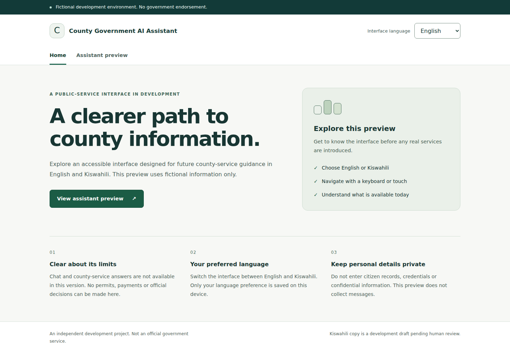
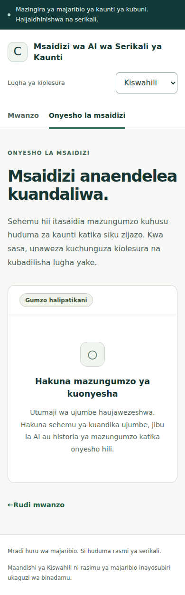

# P1-03 frontend verification

Verified on 2026-10-16 against the P1-03 feature branch. This is evidence for a
fictional development shell, not a real county service or accessibility certification.
See [setup and architecture](../frontend/README.md) and the
[pre-pilot gate](PRE_PILOT_GATE.md).

## Automated results

| Check | Actual result |
| --- | --- |
| Clean locked install | `npm ci` passed on isolated Node 24.22.0/npm 11.19.1, without force/legacy-peer flags |
| Full dependency tree | `npm ls --all` passed; no incompatible peers |
| Dependency audit | `npm audit --audit-level=high` passed; zero reported vulnerabilities at verification time |
| ESLint and Prettier | Passed |
| Strict TypeScript | Passed with unchecked-index and exact-optional checks |
| Vitest/Testing Library | 27 tests passed across five files |
| Production build | Passed; static assets only, no backend dependency |
| Vite development smoke | Direct `/assistant` navigation and Kiswahili reload passed on loopback |
| Playwright | 48 tests passed across Chromium, Firefox and WebKit |
| axe | 18 page/language/engine scans passed with zero violations for selected WCAG tags |
| Backend regression | 60 unit tests passed; backend Ruff lint/format passed |
| Repository tooling regression | Nine tests passed, including bounded screenshot handling |
| Coursework preservation | 213,646 baseline files/symlinks compared read-only; zero changed or missing |

Frontend tests cover home/placeholder/404, history, reload/deep links, language and
title changes, storage denial/invalid values, dictionary parity/fallback, error
boundaries, safe text, keyboard controls, skip link, focus and absence of external
requests. Browser storage contains only the language enum.

Layout checks cover 320, 768 and 1440 CSS pixels in both languages, plus 200% root
text enlargement at 320 pixels. Enlarged text initially exposed overflow in the
brand/button and long Kiswahili words; wrapping was corrected and the full browser
suite passed. These font-size/reflow tests are not native browser zoom tests.
Reduced-motion behavior is checked in all three engines.

Browser tooling: Playwright 1.64.1 test Chromium 156, Firefox 157 and WebKit 27.2.
A fresh Linux host initially lacked four required WebKit libraries; they were
installed and all WebKit tests then ran successfully. No planned automated browser
suite remains skipped. Node is isolated under `/tmp`; the system Node installation
and coursework environments were not changed. Playwright emits a tooling-only
NO_COLOR/FORCE_COLOR warning in this environment; it does not fail checks.
Backend tests retain the previously documented upstream Starlette/AnyIO warning.

## Visual evidence and manual-check status

The agent opened and visually inspected both PNGs below. Desktop layout has a
readable two-column welcome section and consistent three-column scope cards.
Mobile Kiswahili layout wraps the header, navigation and draft copy without clipping;
the assistant is visibly unavailable, with no composer/history. No official seal,
county logo or endorsement claim appears.

| Review | Status / limitation |
| --- | --- |
| Desktop/mobile screenshot inspection | Completed by agent; reviewer should inspect the actual interface too |
| Keyboard Tab/Enter, native selector, skip link, focus after routes/language changes | Automated with browser keyboard events; visible focus styles present |
| Contrast, labels, landmarks, announcements | axe plus component/browser assertions; no automated scan proves full WCAG conformance |
| Native browser 200%/400% zoom | Pending human review; automated checks exercise text enlargement and 320px reflow |
| Screen readers such as NVDA and VoiceOver | Pending human review; no interactive screen-reader session available here |
| Current installed Chrome/Edge and macOS/iOS Safari | Pending human/device review; engine tests are not identical to these branded browsers |
| Kiswahili linguistic/cultural review | Pending fluent human review of every dictionary key before pilot |

WCAG 2.2 AA remains the target. Resolve manual findings before any public/pilot
release. Draft Kiswahili approval is explicitly separate from dictionary completeness.
No real-data operation or deployment is authorized by successful tests.

## CI and artifact boundary

The new Frontend workflow runs pinned Node/npm, clean locked installation,
compatibility/security, lint/format/types/component tests, production build and all
three browser engines with axe. Existing backend/PostgreSQL/docs/secrets jobs remain.
Hosted results are attached to the implementation PR and must be verified before
merge; local results alone do not establish hosted success.

Only the two named review PNG paths are allowed as binary artifacts by the repository
validator, with signature/chunk/checksum/size/dimension checks. Other files retain
existing text, secret-path, symlink and artifact restrictions. Browser traces and
reports stay ignored. Screenshot validation is an artifact-integrity check, not a
privacy or vulnerability certification. Both committed images contain synthetic UI.

## Remaining milestone boundary

The shell needs no database, authentication or AI. Do not add a working composer,
provider calls, conversation persistence or real county content in this milestone.
P1-04 Compose requires a separate approval after review of this PR. Future hosting
must supply same-origin routing/SPA fallback and the approved security headers.
