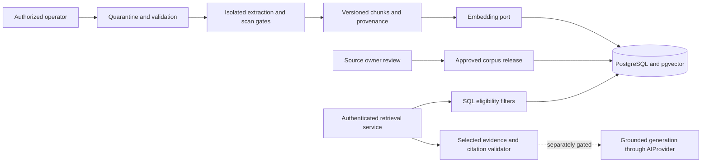

# Public-document RAG architecture — proposed, not implemented

Planning authority: owner request following merged Phase 3 scope-amendment PR #45.
This document elaborates the existing [architecture](ARCHITECTURE.md#secure-rag-phase-4-inactive-in-mvp)
and [planned schema](DATABASE_DESIGN.md#future-document-rag-schema-not-mvp-migrations).
It does not authorize ingestion, parsing, embeddings, inference or image changes.

## Reuse and actual implementation boundary

Keep the modular monolith: FastAPI API/services/repositories, SQLAlchemy/PostgreSQL,
explicit Alembic migrations, role-separated maintenance, existing sessions/ownership,
privacy-safe audits, language handling and versioned prompts. Existing AIProvider
provides asynchronous generate/aclose and normalized errors/usage/completion;
GenerationRequest has current provider-specific context/output limits. Do not assume
it supports embeddings or enlarge its caps silently. Add a separate reviewed
EmbeddingProvider port with embed/aclose, model revision, dimension and normalized
errors. Fake embeddings test wiring, not semantic retrieval quality.

The repository has no implemented knowledge ingestion, vector schema, approved corpus,
embedding model or retrieval endpoint. The PostgreSQL image is currently PostgreSQL17,
not an approved pgvector image. Extension packaging/version/dimension must be chosen,
pinned, scanned and authorized before a changed database environment runs. No
microservice or standalone vector database is needed. A sandboxed operator subprocess
from the same artifact is a security boundary, not a separate product service.

## Proposed initial ingestion contract

Operator-only local file import; no browser upload, crawler or arbitrary URL fetch.
Initial allowlist: text-based PDF and UTF-8 text. Proposed reviewable limits:10MiB
raw file,200 PDF pages,10MiB extracted UTF-8,30s parse deadline,512MiB memory, one
parser worker,5,000 chunks/document. These are proposed defaults to approve/test in
P4-01; reaching a limit rejects the version rather than silently truncating it.
Reject encrypted PDFs, scripts/attachments/embedded objects, archives, executables,
polyglots and unrecognized magic/type combinations; extension alone is insufficient.
No OCR, DOCX/HTML import or macro handling in the mandatory first release.

Use random storage keys in private non-executable quarantine, outside static hosting;
reject symlinks/path traversal and never use an uploaded name as a path or command.
Verify SHA-256, declared provenance and supplied MIME against magic bytes. An approved
scanner with current signatures must succeed before isolated extraction; missing
scan evidence fails closed. Parsing must have no network, no secrets, non-root UID,
read-only root, dedicated scratch, CPU/memory/time/output/process limits and cleanup.
Pin/review parser and scanner dependencies and their scan impact before selection.
No shell interpolation, external entity resolution or remote resource loading.
Public documents can still contain personal data: reject/quarantine personal or
confidential content for authorized review, not automatic publication.

Normalize Unicode NFC and line endings while retaining original page/section/span
mapping and checksums. Preserve tables, numbers and official names; do not rewrite or
translate evidence. Proposed token-aware chunks target400 tokens, overlap50, cap600,
using a pinned tokenizer/chunker version. Review table/section boundaries and reject
unmappable output. English/Kiswahili metadata is source-declared and review-verified;
mixed language is explicit. No embedding model download or tokenizer dependency is
selected here. No conversation/account content is ever embedded as knowledge.

## Lifecycle, schema and publication

Use existing planned entities, with reviewed additions rather than parallel tables:

| Entity | Constraints and proposed additions |
| --- | --- |
| documents | UUID, county/department, accountable owner, canonical approved URL, public classification, withdrawn_at; source identity unique in scope |
| document_versions | FK, unique document/version, immutable content hash/storage key, language, effective/review-due dates, parser/chunker versions, scan evidence and reviewer; append-only content |
| document_chunks | Unique version/ordinal, exact page/section/span, chunk checksum and bounded text; FK integrity |
| embedding_spaces | Unique provider/model/revision/tokenizer/chunking/metric identity, positive fixed dimension; never infer identity from model alias alone |
| chunk_embeddings | Unique chunk/space, non-null finite vector of reviewed fixed dimension; migration fixes dimension per space/table or partition |
| corpus_releases | Immutable approved membership, space identity, checksums, approval/evaluation evidence, activation/rollback pointers |
| ingestion jobs and audit | Durable idempotent job/lease/error code and bounded retries; actor/source/version/action/result/time only; no document bodies or credentials |

Legal transition: quarantined -> validated -> extracted -> embedded -> reviewed ->
published via approved corpus activation. Failure/rejection cannot become published.
Approval is a separate authorized source-owner action, never implied by successful
parsing/scanning or an administrator JWT. Keep mutable review/publication metadata
separate from immutable content; stale/expired/withdrawn state excludes a version.
Effective-date and review-due predicates use server time. Idempotency keys bind file
hash and processing recipe; concurrent jobs cannot duplicate chunks/embeddings.
Provider calls occur outside database transactions; commit complete batches with
conditional job leases, deadlines and bounded retry. No partial corpus activation.

Build replacement releases alongside active data. Atomically switch the active
release after approval and evaluation. Rollback can select only still-eligible
sources; it must not resurrect withdrawn/expired content. Tombstone/revocation
immediately removes eligibility; purge asynchronously covers files, extracts, chunks,
vectors, caches and artifacts subject to approved holds. Audit holds/release/review
under the existing privacy principles; do not automatically reuse conversation-hold
schema for documents without contract review. Historical citations retain immutable
identity but not withdrawn text. Restore must replay revocations/deletion before
serving. Purge targets/backup retention require explicit source/privacy approval.

## Retrieval and citation contracts to review in P4-01

Internal typed request: bounded query, en/sw preference and server-owned county,
corpus and embedding-space context. Proposed caps:4,000 query characters, top_k5
(max10), five evidence chunks and3,000 evidence tokens, subordinate to existing
GenerationRequest/model context limits. Reject oversize mandatory evidence rather
than silently expanding provider caps. Client cannot set approval/classification,
SQL, model URL or unrestricted corpus/space IDs.

Authenticated retrieval requires valid current session/account. Staff/admin receive
no implicit wider document access. Ingestion/approval/revocation use separate
operator capabilities and DB grants, not public runtime permissions. A retrieval
HTTP route is not yet approved; API_SPECIFICATION currently excludes document/search
routes. P4-01 must review exact paths, schemas/statuses before implementation:
401 invalid authentication,403 denied operator action,422 validation,429 quota,
503 unavailable service and a structured no_evidence outcome without model dispatch.
Use indistinguishable source-not-found behavior for unauthorized IDs.

Start with exact cosine similarity over eligible rows and deterministic UUID tie
breaks. SQL joins enforce approved publication, public classification, county,
active corpus/space, effective/review dates and withdrawal exclusions before scoring
and LIMIT. Index filter keys; no ANN/post-filtering shortcut. Language is a measured
retrieval preference, not a blanket filter that hides relevant cross-language
sources. Tune thresholds on development data then freeze before held-out evaluation.
No similarity score alone establishes factual support. Compare an offline lexical
baseline; ANN/hybrid/reranking require measured need and separate design approval.
See [official pgvector guidance](https://github.com/pgvector/pgvector#querying)
for exact search and filtering tradeoffs; no version is selected in this plan.

Evidence result: source/version/chunk IDs, hash, language, official title/URL,
effective/review dates, page/section/span and bounded text. Citation IDs are allocated
by the server from the selected evidence, never accepted from the model as authority.
Allow only approved HTTPS citation origins; no javascript/data URLs, arbitrary
redirects or automatic source fetching. Recheck eligibility immediately before
emitting output/citation resolution, including in-flight withdrawal. Cache keys bind
release/space/eligibility epoch; revocation invalidates caches and pending results.

## Grounding, secrets and privacy

Retrieved text is untrusted data under separate system instructions. It cannot
change role, destination, authorization, invoke tools or request secrets. Preserve
server-owned abstention; missing/expired/conflicting evidence must fail closed with
safe en/sw messages. Validate every citation against selected eligible chunks and
assess claim support independently: a real citation does not prove entailment.
No fabricated county fees, procedures or regulations; quote only current approved
support. Never render raw document/model HTML. No automatic cross-provider failover.
No generation dispatch until #39 quality/latency, #44 lifecycle/context/usage gates
and exact runtime/data approvals pass. Fakes may test evidence wiring separately.

Proposed retrieval limit10/minute/user, burst3, global concurrency2 and ingestion
concurrency1 must be approved/measured; enforce shared counters, output/body/time caps
across workers. Do not reuse login throttles as retrieval quota implementation.
Log trace/actor pseudonym/source IDs, counts, timings and fixed failure codes, never
queries, raw documents, prompts, vectors, credentials or private file paths.
Backend-only secret mounts; no VITE keys. Scanner and embedding endpoints must be
allowlisted, with no unapproved external data flow. URL import, if added later,
requires redirect/DNS/IP revalidation and private/link-local/metadata blocking.

Kenya applicability is a pre-pilot legal/privacy decision. Public availability is
not permission to reuse personal details: minimize data, establish purpose/lawful
basis, source authorization and rights/retention process; screen DPIA/registration
and transfer obligations before real data. This is architecture, not compliance
certification. Sources reviewed for planning on21October2026:
[ODPC principles and rights](https://www.odpc.go.ke/rights-of-a-data-subject/),
[ODPC public-sector guidance](https://www.odpc.go.ke/wp-content/uploads/2025/11/ODPC-%E2%80%93-Guidance-Note-FOR-PUBLIC-SECTOR.pdf),
[ODPC laws and regulations](https://www.odpc.go.ke/data-protection-laws-kenya/).
No real government/citizen data is authorized by this planning PR.
