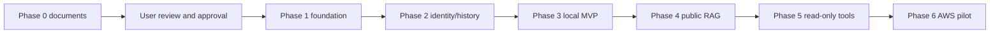

# Milestone roadmap

Status: updated 2026-10-17. Phase 1 technically closed through PR #16 at
c49998ff2c8ec371085e2c1a5341ba60af4f2ec1; issue #7 records owner acceptance and the
actual dated human CRITICAL review. Production security approval remains pending.
Ruleset 25222082 remains enforced. P2-01 backend implementation is authorized only
from reviewed, merged contracts; later work requires separate approval. Development
remains fictional/synthetic only. Estimates assume one focused engineer
with access to a county content reviewer and privacy/security reviewer. Parallel
organizational review is possible; no sub-agent delegation or extra engineering team
is assumed. Part-time work, procurement, credentials, approvals and county source
review can extend elapsed time. Estimates are effort windows, not calendar promises.

[Requirements](REQUIREMENTS.md) defines scope; [architecture](ARCHITECTURE.md),
[database](DATABASE_DESIGN.md), [API](API_SPECIFICATION.md),
[security](SECURITY.md) and [ADR 0001](DECISIONS/0001-modular-monolith.md) define
the proposed implementation baseline. Coursework stays read-only.

## Phase 3 scope amendment — owner approved 21 October 2026

Phase 3 is CONDITIONALLY ACCEPTED for the delivered provider, bilingual prompt,
benchmark and evaluation-research foundation only. Documentation closeout awaits
owner review/merge. [ADR 0005](DECISIONS/0005-phase-3-research-scope.md) and the
[acceptance report](PHASE_3_ACCEPTANCE.md) record the explicit scope change.
The original Phase 3 row below is preserved as the deferred assistant-MVP baseline;
its exit criteria have not passed. Mandatory generation/recovery, bounded context,
catalogue/source controls, quotas and generation UI are tracked in
[issue #44](https://github.com/Abdalla-Wasaa/Production-Grade-County-Government-AI-Assistant/issues/44).
Independent bilingual review and latency remain in OPEN
[issue #39](https://github.com/Abdalla-Wasaa/Production-Grade-County-Government-AI-Assistant/issues/39).
No mandatory live-generation safety requirement becomes optional. The later approved
local fake/Ollama provider choice supersedes the original initial-OpenAI assumption;
an OpenAI adapter remains future separately approved scope, not a required addition
for this amended research closure.

After owner-reviewed conditional closure, Phase 4 planning may proceed independently
of unresolved live-generation readiness. This limited exception amends the dependency
arrow below for planning only. Phase 4 implementation/RAG, P3-04 live generation,
real-data processing and production remain unauthorized. Security renewal PR #43 is
effective through 30 October 2026, 23:59 EAT for the unchanged accepted exposure;
historical expiry statements below do not renew or override that decision.

## Milestones and acceptance criteria

| Phase / effort estimate | Deliverables | Exit criteria and evidence |
| --- | --- | --- |
| 0: architecture and requirements, merged | Seven linked design documents plus ADR; coursework-informed decisions | Completed through merged PR #1; product features still follow their own milestone gates |
| 1: foundation, 1 week | Isolated frontend/backend packages; locked dependencies; settings; Docker/Compose PostgreSQL; migration framework; CI skeleton; localized UI shell | Fresh clone starts with documented synthetic setup; non-root containers and live/ready behavior verified; frontend build/lint/types and backend smoke/migration checks pass; no live model or citizen data |
| 2: identity and conversations, 2–3 weeks | Invite-only acceptance/provisioning procedure; secure sessions; users/conversations/messages migrations; API and bilingual history UI | API contract tests pass; role/ownership 401/403/404 tests; CSRF/rotation/revocation/concurrency tests; ordered history and cascade deletion verified; privacy notice/retention job tested; no provider dispatch |
| 3: bounded OpenAI assistant MVP, 3–4 weeks | Provider port + OpenAI adapter; reviewed service catalogue; bounded memory; durable attempts/retry/recovery; quota/budget ledger; bilingual replies and source/abstention UI | All FR-01..FR-10 verified for closed pilot; >=100 reviewed held-out cases and per-language gates; failure/deletion/replay tests; 10-user load measurement, token/spend caps and deadline checks; provider/privacy approval before any real-data call |
| 4: secure public document RAG, 3–4 weeks | Source registry; immutable versions; scanned extraction; chunking/embedding adapter; pgvector migrations; exact retrieval baseline and corpus activation | Owner approves every released source; bilingual retrieval Recall@5 target >=0.85 per language on >=50 relevant cases/language; no unauthorized/withdrawn source in adversarial tests; citation/abstention gates retained; rollback and document purge verified; record benchmark denominators |
| 5: controlled read-only tools, 2–3 weeks | Allowlisted directory/status adapters, schemas, server authorization, result validation and audit | Unknown/unauthorized tools and tampered scopes denied; maximum 2 calls/turn and deadlines enforced; offline adapter contracts and approved sandbox checks pass; no payment/permit/record mutation |
| 6: AWS deployment and operational pilot, 2–3 weeks | Reviewed AWS topology/region; managed secrets/DB; protected deployment pipeline; monitors/runbooks; pilot release record | Hosting/transfer/DPIA/identity approvals; real PostgreSQL restore with deletion replay; RPO/RTO demonstration; load/cost evidence; rollback and incident drills; county reviewers sign off residual risks before real users |

Closed-pilot local MVP: approximately 6–8 focused engineering weeks after Phase 0
approval. Phases 1–6 total approximately 13–18 engineering weeks, excluding review
waits and procurement. The cloud milestone is not required to demonstrate a local
synthetic MVP; local success is not evidence of public-production readiness.

Phase 4 recall target is a proposed evaluation gate, not current measured quality.
Adjust corpus scope or retrieval method if evidence fails; never relax privacy or
silently reduce the benchmark denominator to pass. RAG remains disabled until its
own gate; tools remain disabled until their gate.

## Dependency and approval flow

Every arrow after a phase also requires explicit user approval; diagram arrows are
dependencies, not permission. Use feature branches and PRs; Conventional Commits;
attach actual checks and risks; obtain approval before merge and before starting
another phase. No direct commits to main after initialization. The historical Phase 0 stop gate applied to that milestone; it does not override
subsequent explicit authorizations recorded in the merged implementation PRs.

## Work breakdown and release evidence

Each milestone starts with issues containing observable acceptance criteria and a
bounded scope. PRs separate schema changes, API behavior, frontend UX and AI policy
where review benefits, while coordinating contracts. Implementation changes include
meaningful tests. Record architectural changes through ADRs, including rejected
alternatives and measured reasons. Do not copy coursework scripts or datasets.

Deliver an evidence bundle per milestone: commit IDs, test results, generated API
schema, reviewed fixtures/benchmark version, privacy/security decisions, measured
latency/cost where relevant, limitations, and rollback plan. Paid smoke evaluations
must be budget-limited and separately enabled; CI normally uses fakes/synthetic data.

## Risks and dependencies to resolve

| Dependency / risk | Owner / mitigation | Needed by |
| --- | --- | --- |
| Real pilot county/scope, participants, catalogue approval, staffing and operational budget | Owner-approved fictional/synthetic development proceeds; real owners/reviewers and resources must pass the pre-pilot gate | Before real pilot; deferred by owner on 2026-10-16 |
| Auth invitation delivery | P2-01 synthetic operator-file handoff and one-time activation/reset contract under review; real-pilot delivery still requires approval | Phase 2 / pre-pilot |
| No approved catalogue or bilingual benchmark | Department owners and English/Kiswahili reviewers prepare provenance-backed public material and independent cases | Phase 3 |
| Provider account/model, token budget and pricing approval | Owner chooses evaluated configuration and spend ceiling; engineer tests adapter capabilities and records actual rate assumptions | Phase 3 live calls |
| Sensitive data and overseas processing | County privacy/legal lead maps purposes, roles, locations, safeguards, retention and DPIA requirements | Before any real-data provider processing |
| Vector retrieval coverage and index compatibility | Engineer tests exact baseline, language slices, version/dimension isolation, future managed-DB extension support | Phase 4 |
| County API contracts/sandbox unavailable | Use fakes until official sandbox/authorization exists; do not invent production integrations | Phase 5 |
| AWS account, service/region/cost and operational owner | Owner approves deployment ADR; engineer validates managed DB/pgvector, restore, IAM and cost envelope | Phase 6 |

## Post-pilot, separately approved backlog

Public registration/email verification/recovery and staff SSO/MFA; Azure OpenAI and
Bedrock adapter parity; multi-county tenancy; human feedback/quality review workflow;
streaming/queues; staff-only RAG; multilingual voice/attachments; controlled record
updates with exact-action confirmation. Each requires contracts, permission/data
lifecycle review and acceptance evidence before activation. Fine-tuning or services
extraction require measured need rather than coursework precedent.

## Approved synthetic development and issue gates

The owner's amendment permits fictional county information only; no real citizen
records, county credentials, confidential documents, payments, public deployment or
live county integration. See [pre-pilot decision gate](PRE_PILOT_GATE.md). All
implementations require dedicated branches, tests, green relevant CI and the sole
maintainer's review before merging. A green check is not approval to merge/start
another issue. P1-01 through P1-05 are merged. P1-06 is authorized for documentation and evidence
only in that historical stage; P2-01 now follows the approval gate below.

Phase 1 issues: [P1-01 backend](https://github.com/Abdalla-Wasaa/Production-Grade-County-Government-AI-Assistant/issues/2),
[P1-02 database/migrations](https://github.com/Abdalla-Wasaa/Production-Grade-County-Government-AI-Assistant/issues/3),
[P1-03 frontend](https://github.com/Abdalla-Wasaa/Production-Grade-County-Government-AI-Assistant/issues/4),
[P1-04 Compose](https://github.com/Abdalla-Wasaa/Production-Grade-County-Government-AI-Assistant/issues/5),
[P1-05 CI integration](https://github.com/Abdalla-Wasaa/Production-Grade-County-Government-AI-Assistant/issues/6),
[P1-06 acceptance](https://github.com/Abdalla-Wasaa/Production-Grade-County-Government-AI-Assistant/issues/7).
P1-01 provides dependency-free liveness, settings/lifecycle/error/logging foundations
and backend checks. P1-02 adds PostgreSQL sessions, baseline migrations, readiness
and real-database CI. P1-03 adds the independent bilingual frontend shell, with
draft Kiswahili copy behind human review before pilot. P1-04 adds the isolated
local Compose environment with explicit migrations, synthetic secrets and
disposable acceptance checks; domain/chat functionality remains excluded.

## Historical P1-05 implementation scope

PR #12 is merged. The owner authorizes ci/p1-05-quality-gates for CI/tooling,
scoped backend typing, dependency/image audits, reporting, actual-Nginx browser
smoke, workflow-policy tests and daily security monitoring. Issue #6 is reopened
because previous completion markers lacked this milestone's evidence. Its exit
requires actual hosted context verification, negative-test evidence and explicit
residual-risk decisions; a green functional suite alone is insufficient.
GitHub required-check/ruleset configuration needs separate approval and remote
verification. No ruleset changes or P1-06 work are authorized. See [CI.md](CI.md).

## Historical P1-06 acceptance gate

Issue #7's prior closure/checkmarks were premature relative to this final replay.
The owner authorized reopening it while preserving its original criteria/history.
[Phase 1 acceptance](PHASE_1_ACCEPTANCE.md) maps each criterion to exact-commit
results, limitations and owner decisions. Missing isolated onboarding or human
security-review evidence stays pending. Foundation acceptance is development-only;
production security approval and Phase 2 implementation are separate decisions.

## Phase 2 tracking and execution order

The Phase 2 exit criteria above are unchanged. The owner authorized creation of the
following tracking breakdown; issue existence is not permission to start later work.
P2-01 is backend-only. Contract/ADR review comes first; implementation follows from
its reviewed, merged main on feat/p2-01-account-authentication. No self-merge.

- [P2-01 Invite-only account activation and secure backend authentication](https://github.com/Abdalla-Wasaa/Production-Grade-County-Government-AI-Assistant/issues/17)
- [P2-02 Bilingual frontend authentication integration](https://github.com/Abdalla-Wasaa/Production-Grade-County-Government-AI-Assistant/issues/18)
- [P2-03 Private conversation and message persistence APIs](https://github.com/Abdalla-Wasaa/Production-Grade-County-Government-AI-Assistant/issues/19)
- [P2-04 Bilingual private conversation history interface](https://github.com/Abdalla-Wasaa/Production-Grade-County-Government-AI-Assistant/issues/20)
- [P2-05 Privacy notices retention and account lifecycle](https://github.com/Abdalla-Wasaa/Production-Grade-County-Government-AI-Assistant/issues/21)
- [P2-06 Identity and conversations acceptance verification](https://github.com/Abdalla-Wasaa/Production-Grade-County-Government-AI-Assistant/issues/22)

Dependencies: P2-02/P2-03 follow P2-01; P2-04 follows P2-02/P2-03; P2-05 depends on
identity/history; P2-06 verifies all preceding work. Detailed tasks and measurable
criteria live in the issues. Authentication/role/session contracts are in
[AUTHENTICATION.md](AUTHENTICATION.md) and [ADR 0002](DECISIONS/0002-invite-only-authentication.md).
The historical P1-05/P1-06 authorization paragraphs above record their original
scope; the dated Phase 1 closure supersedes their pending status, not their evidence.

The exposure-hash policy blocks inheriting Phase 1 acceptance for new application
code, migrations or locks. Focused assessment, current scans and any policy-required
owner decision precede changed-runtime execution under an exception. Do not modify
acceptance records or bypass CI. Production remains prohibited; the existing
23 October 2026, 23:59 EAT expiry and daily human review obligation are unchanged.

## P2-01 validation status, 17 October 2026

Contract PR #23 is merged. The owner authorized isolated synthetic backend/PG/Compose
validation and bounded fixes only. Issue #17 remains open: nine auth routes, six
tables and three explicit migrations are implemented and exercised; frontend auth,
conversations and later issues are not started. [Actual evidence](P2_01_EXPOSURE_ASSESSMENT.md)
records 112 backend tests and the real-proxy flow, not Phase 2 completion. The
unchanged exposure and complete-package inventory gates still reject new code.
No policy-record/expiry change or merge is authorized; seven-check enforcement remains.
